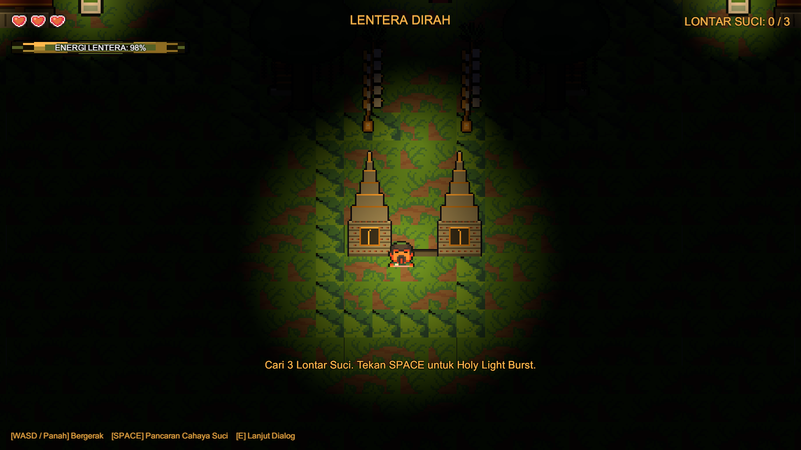
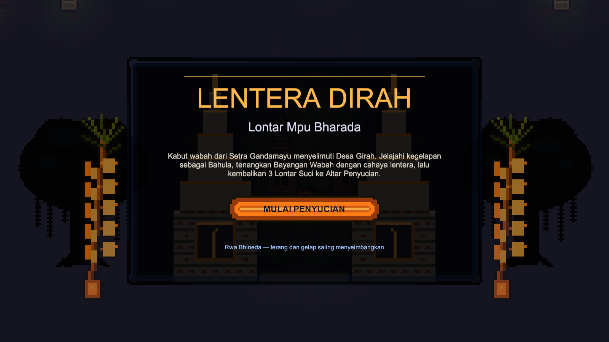
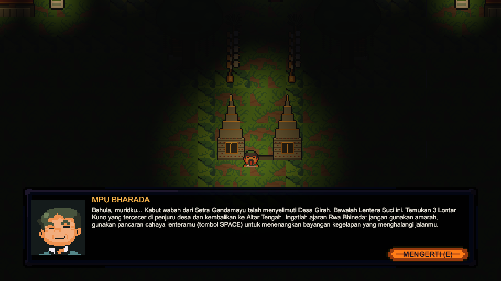
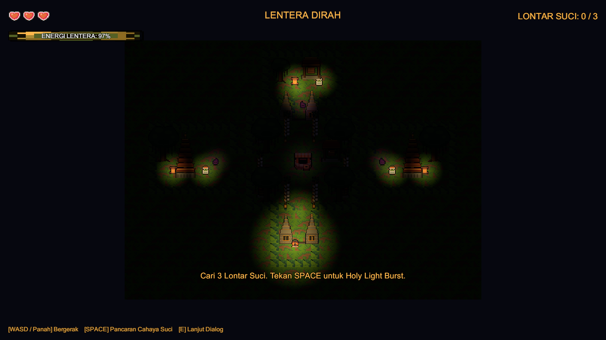

# Lentera Dirah: Lontar Mpu Bharada

Prototipe game 2D top-down bertema budaya Bali (*Calonarang* / filosofi *Rwa Bhineda*).
Dibuat dengan **Unity 6000.6.9f1** + **URP 17.6 (2D Lights)** untuk mata kuliah Pengembangan Permainan Digital — ITB STIKOM Bali.

> Jelajahi kegelapan Desa Girah sebagai **Bahula**, tenangkan **Bayangan Wabah** dengan cahaya Lentera Suci, dan kembalikan **3 Lontar Kuno** ke **Altar Penyucian** tanpa kekerasan.



## Fitur

- **Core loop** `Explore → Evade & Stun → Collect → Purify`
- **FSM 3 level**: `GameManager` (MainMenu/IntroDialog/Playing/Victory/GameOver), `PlayerController` (Idle/Walking/CastingLight/Hurt), `EnemyShadowAI` (Patrol/Chase/Stunned)
- **Mekanik 1** — Sacred Lontar Collection & Altar Seal: 3 Lontar (Usada, Dharma, Rwa Bhineda) membuka segel Altar
- **Mekanik 2** — Dynamic Lantern & Holy Light Burst: energi menyusut **2%/dtk** (radius `Light 2D` 6.0→1.8), Minyak Obor **+35%**, `SPACE` = burst **-15%** energi, cooldown **4 dtk**, stun radius **3.5** selama **3 dtk**
- Collision solid (TilemapCollider2D) & trigger (item, altar), kamera smooth-follow, animasi 4 arah, BGM + 5 SFX
- **Unsur budaya Bali**: gapura/candi bentar sebagai pintu keluar desa & gerbang sektor utara, pohon beringin berakar gantung, pura meru bertingkat, bale kulkul, pelinggih, dan penjor — plus latar gapura/beringin/penjor di main menu
- **Automasi editor**: seluruh scene dirakit 1 klik dari menu `Tools → Lentera Dirah`

| Menu | Dialog | Gameplay |
|---|---|---|
|  |  |  |



## Struktur Repository

```
.
├── Game/                      # Proyek Unity (dibuka lewat Unity Hub)
│   ├── Assets/_Project/       # Art, Audio, Prefabs, Scenes, Scripts
│   ├── Docs/                  # Screenshot hasil render
│   ├── Packages/  ProjectSettings/
│   └── Builds/macOS/          # executable .app (tidak di-commit, build lokal)
├── Documents/                 # GDD, Laporan Studi Literatur, Referensi Aset
├── IMPLEMENTATION_PLAN.md     # Rencana & status 6 fase
└── README_GAMEPLAY.md         # Panduan main, checklist rubrik, build, skenario video
```

## Menjalankan

1. Unity Hub → **Add** → pilih folder `Game/` → buka dengan **Unity 6000.6.9f1**.
2. `Tools → Lentera Dirah → 1. Configure Pixel Art Assets & Tags`
3. `Tools → Lentera Dirah → 2. Build Complete Prototype Scene`
4. Tekan **Play** → **MULAI PENYUCIAN** → `E` lanjut dialog → jelajah, `SPACE` untuk stun, ambil 3 Lontar → sentuh Altar.

Kontrol: `WASD`/panah bergerak · `SPACE` Holy Light Burst · `E` lanjut dialog.

## Build & Uji

- Build macOS: `Tools → Lentera Dirah → 3. Build macOS App` → `Game/Builds/macOS/LenteraDirah.app`
- Uji otomatis (19 assertion, play-mode):
  ```bash
  "/Applications/Unity/Hub/Editor/6000.6.9f1/Unity.app/Contents/MacOS/Unity" \
    -batchmode -projectPath "$(pwd)/Game" \
    -executeMethod LenteraDirah.Editor.PlayModeSmokeTest.Run -logFile -
  ```

Detail lengkap: [`README_GAMEPLAY.md`](README_GAMEPLAY.md) · rencana fase: [`IMPLEMENTATION_PLAN.md`](IMPLEMENTATION_PLAN.md)

## Aset & Lisensi

- [**Ninja Adventure Asset Pack**](https://github.com/pixel-boy/NinjaAdventure) — Pixel-Boy & AAA, **CC0 1.0** (karakter, monster, item, tileset, UI, font, SFX, BGM). Teks lisensi: `Game/Assets/_Project/LICENSE_NinjaAdventure_CC0.txt`.
- **Aset lingkungan Bali** (gapura, beringin, meru, bale kulkul, pelinggih, penjor) — dibuat khusus untuk proyek ini via `Game/Tools/generate_balinese_assets.py`, dilepas **CC0 1.0** (`Game/Assets/_Project/Art/Environment/LICENSE_CC0.md`).
- **Universal Render Pipeline 2D Lights** — Unity Technologies (Unity Companion License).
- Kode game pada repository ini ditulis untuk keperluan akademik.
