# Lentera Dirah: Lontar Mpu Bharada

Prototipe game 2D top-down bertema budaya Bali (*Calonarang* / filosofi *Rwa Bhineda*).
Dibuat dengan **Unity 6000.6.9f1** + **URP 17.6 (2D Lights)** untuk mata kuliah Pengembangan Permainan Digital — ITB STIKOM Bali.

> Jelajahi tiga wilayah sebagai **Bahula**, tenangkan **Bayangan Wabah** dengan cahaya Lentera Suci, dan kembalikan **3 Lontar Kuno** ke **Altar Penyucian** di setiap wilayah tanpa kekerasan.

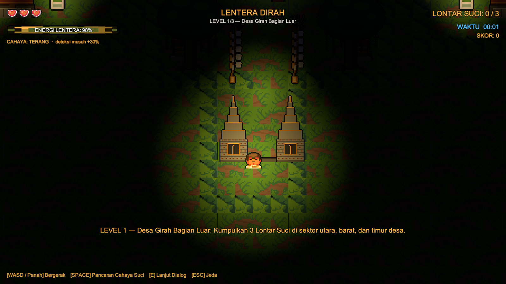

## Fitur

- **Alur final**: `Main Menu → Pilih Kesulitan → Level 1/2/3 → Hasil (skor) → Level Berikutnya / Menu`
- **3 level dengan 2 peta baru**: **Desa Girah Bagian Luar**, **Hutan Bambu Lemah Tulis**, **Pelataran Setra Gandamayu** — masing-masing punya layout, altar, 3 Lontar, 3 Minyak, dan 4–5 Bayangan Wabah
- **Core loop per level** `Explore → Evade & Stun → Collect → Purify`
- **FSM 3 tingkat**: `GameManager` (MainMenu/DifficultySelect/IntroDialog/Playing/Paused/Victory/GameOver), `PlayerController` (Idle/Walking/CastingLight/Hurt), `EnemyShadowAI` (Patrol/Chase/Stunned)
- **Mekanik 1** — Sacred Lontar Collection & Altar Seal: 3 Lontar per level membuka segel Altar setempat
- **Mekanik 2** — Dynamic Lantern & Holy Light Burst: energi menyusut **2%/dtk** (radius `Light 2D` 6.0→1.8), Minyak Obor **+35%**, `SPACE` = burst **-15%** energi, cooldown **4 dtk**, stun radius **3.5** selama **3 dtk**
- **Mekanik 3** — Rwa Bhineda Exposure: lentera terang membuat deteksi musuh hingga **+30%**, lentera redup menyamarkan hingga **-30%**
- **Halaman Pilih Kesulitan** setelah **MULAI BERMAIN**: Mudah / Normal / Sulit (pengali decay, kecepatan, deteksi, dan skor)
- **Skor & gelar**: skor level dari waktu + nyawa + sisa energi × pengali kesulitan; gelar Penyuci Agung / Murid Teladan / Pejalan Malam; skor total dan rekor tersimpan
- **Menu Pengaturan + Jeda**: slider BGM/SFX, layar penuh; `Esc` menjeda permainan
- **Layar Kredit**: atribusi aset dan lisensi
- Persistensi terbatas pada pengaturan dan rekor skor (`PlayerPrefs`) — tanpa save progres
- Collision solid (TilemapCollider2D) & trigger (item, altar), kamera smooth-follow, animasi 4 arah, SFX 5 event
- **Bahula bergaya Bali**: kemeja/kamen putih dengan sabuk emas dan **udeng coklat** (hasil restyle sprite 4 arah, lihat `Art/Characters/LICENSE_Bahula_Restyle.md`)
- **BGM gamelan Bali**: rekaman *Gendér Wayang* (1928) berstatus public domain, loop selama permainan
- **Unsur budaya Bali**: gapura/candi bentar sebagai pintu keluar desa & gerbang sektor utara, pohon beringin berakar gantung, pura meru bertingkat, bale kulkul, pelinggih, dan penjor — plus latar gapura/beringin/penjor di main menu
- **Automasi editor**: seluruh scene dirakit 1 klik dari menu `Tools → Lentera Dirah`

| Menu | Pilih Kesulitan | Pengaturan |
|---|---|---|
| 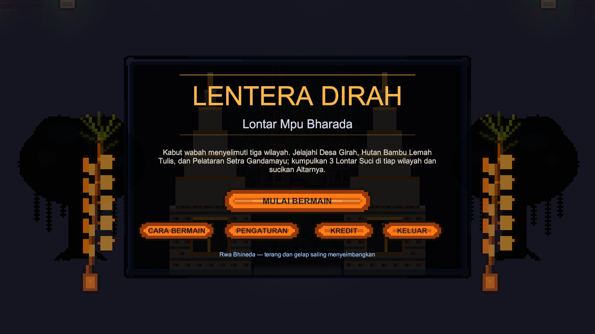 | 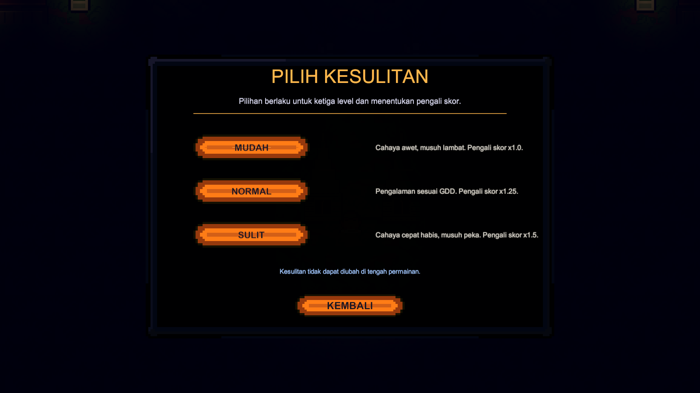 | 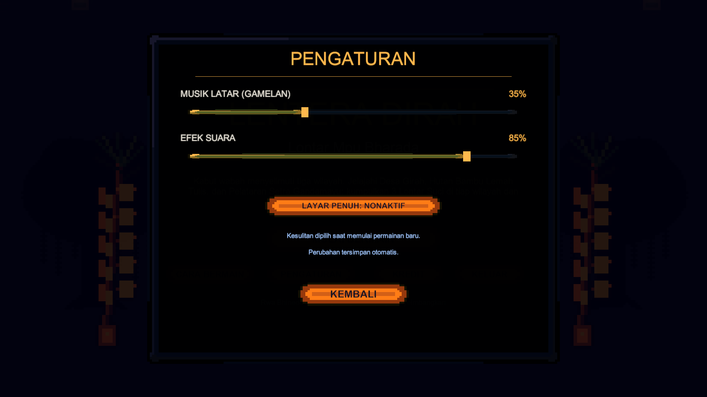 |

| Desa Girah | Hutan Bambu Lemah Tulis | Pelataran Setra Gandamayu |
|---|---|---|
| 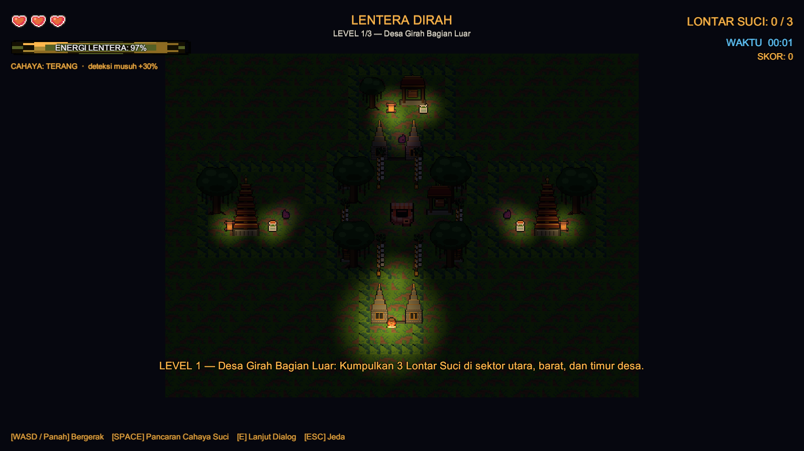 | 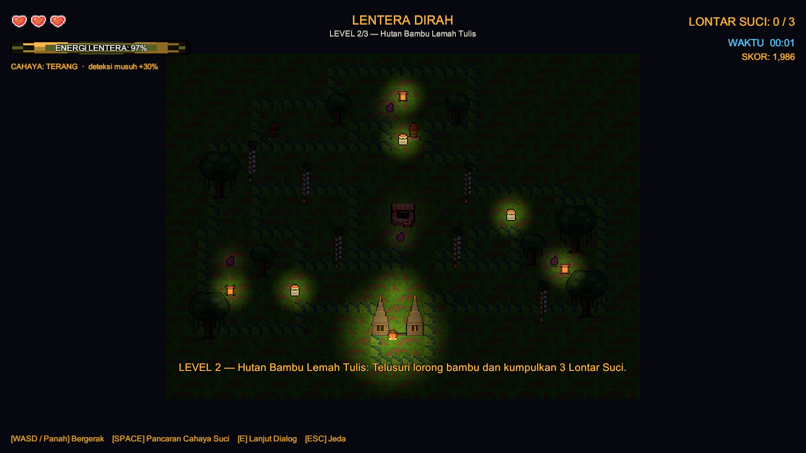 | 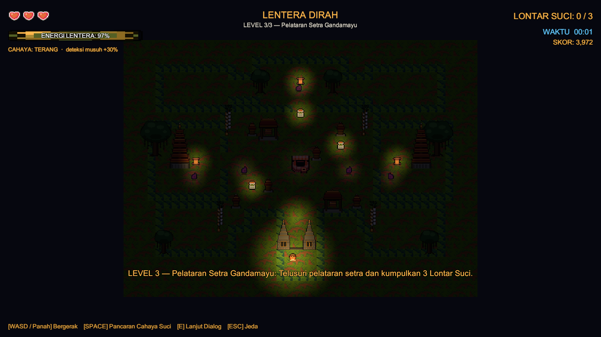 |

| Gameplay | Hasil Level | Hasil Akhir |
|---|---|---|
|  | 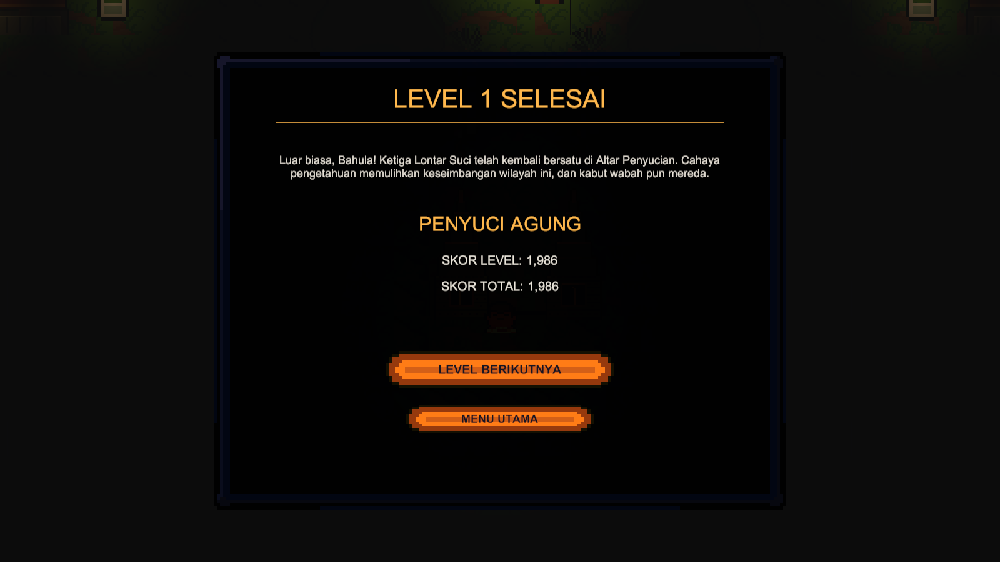 | 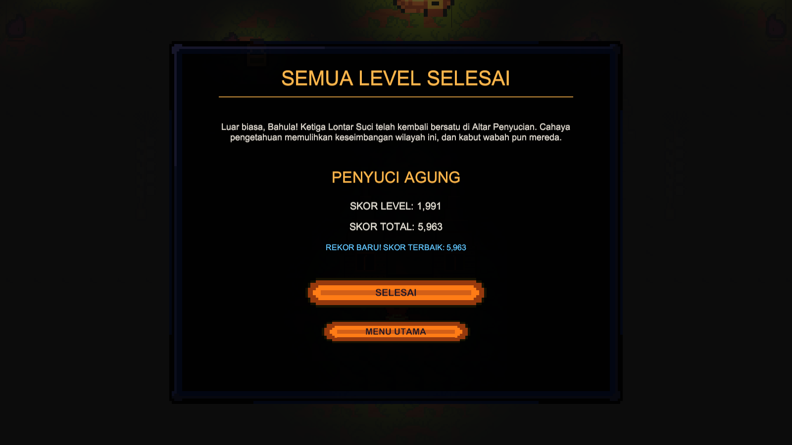 |

| Jeda | Game Over | Kredit |
|---|---|---|
| 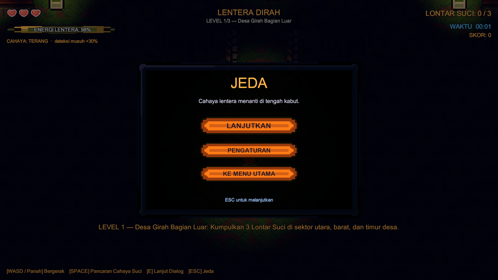 | 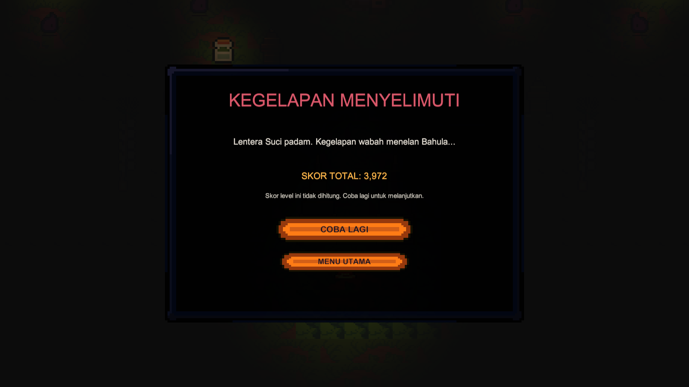 | 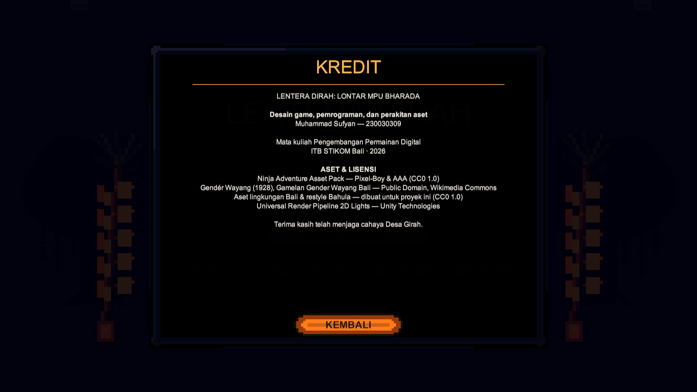 |

## Struktur Repository

```
.
├── Game/                      # Proyek Unity (dibuka lewat Unity Hub)
│   ├── Assets/_Project/       # Art, Animation, Audio, Prefabs, Scenes, Scripts (+ asmdef)
│   ├── Docs/                  # Screenshot hasil render
│   ├── Packages/  ProjectSettings/
│   └── Builds/                # executable macOS/.app & Windows/.exe (tidak di-commit)
├── docs/                      # GDD, laporan, HTML artifact, rencana proyek
│   ├── gdd/  laporan/  html/
│   ├── plan/                  # IMPLEMENTATION_PLAN, REVISI_DOKUMEN, skenario presentasi
│   └── panduan-gameplay.md    # cara jalan, rubrik, build, skenario video
├── tools/                     # skrip Python: assets/ (generator aset), docs/ (generator dokumen)
├── media/gameplay/            # rekaman gameplay (berkas .mp4 tidak di-commit)
└── dist/                      # arsip zip distribusi (tidak di-commit)
```

## Menjalankan

1. Unity Hub → **Add** → pilih folder `Game/` → buka dengan **Unity 6000.6.9f1**.
2. `Tools → Lentera Dirah → 1. Configure Pixel Art Assets & Tags`
3. `Tools → Lentera Dirah → 2. Build Complete Prototype Scene`
4. Tekan **Play** → **MULAI BERMAIN** → pilih **Mudah/Normal/Sulit** → `E` lanjut dialog → jelajah level 1, `SPACE` untuk stun, ambil 3 Lontar → sentuh Altar → lanjut ke level 2 dan 3.

Kontrol: `WASD`/panah bergerak · `SPACE` Holy Light Burst · `E` lanjut dialog · `ESC` jeda/pengaturan.

## Build & Uji

- Build macOS: `Tools → Lentera Dirah → 3. Build macOS App` → `Game/Builds/macOS/LenteraDirah.app`
- Build Windows: `Tools → Lentera Dirah → 3. Build Windows EXE` → `Game/Builds/Windows/LenteraDirah.exe` (x64; butuh modul *Windows Build Support (Mono)*)
- Uji otomatis (74 assertion, play-mode):
  ```bash
  "/Applications/Unity/Hub/Editor/6000.6.9f1/Unity.app/Contents/MacOS/Unity" \
    -batchmode -projectPath "$(pwd)/Game" \
    -executeMethod LenteraDirah.Editor.PlayModeSmokeTest.Run -logFile -
  ```

Detail lengkap: [`docs/panduan-gameplay.md`](docs/panduan-gameplay.md) · rencana fase: [`docs/plan/IMPLEMENTATION_PLAN.md`](docs/plan/IMPLEMENTATION_PLAN.md)

## Aset & Lisensi

- [**Ninja Adventure Asset Pack**](https://github.com/pixel-boy/NinjaAdventure) — Pixel-Boy & AAA, **CC0 1.0** (karakter, monster, item, tileset, UI, font, SFX, BGM). Teks lisensi: `Game/Assets/_Project/LICENSE_NinjaAdventure_CC0.txt`.
- **Aset lingkungan Bali** (gapura, beringin, meru, bale kulkul, pelinggih, penjor) — dibuat khusus untuk proyek ini via `tools/assets/generate_balinese_assets.py`, dilepas **CC0 1.0** (`Game/Assets/_Project/Art/Environment/LICENSE_CC0.md`).
- **BGM** — *Gendér Wayang* (1928), Gamelan Gender Wayang Bali, **Public Domain**, sumber [Wikimedia Commons](https://commons.wikimedia.org/wiki/File:Gend%C3%A9r_Wayang_(1928).ogg); rincian di `Game/Assets/_Project/Audio/BGM/LICENSE_BGM.md`.
- **Restyle Bahula** — turunan CC0 dari Ninja Adventure, dimodifikasi via `tools/assets/restyle_bahula_balinese.py` (`Art/Characters/LICENSE_Bahula_Restyle.md`).
- **Universal Render Pipeline 2D Lights** — Unity Technologies (Unity Companion License).
- Kode game pada repository ini ditulis untuk keperluan akademik.
